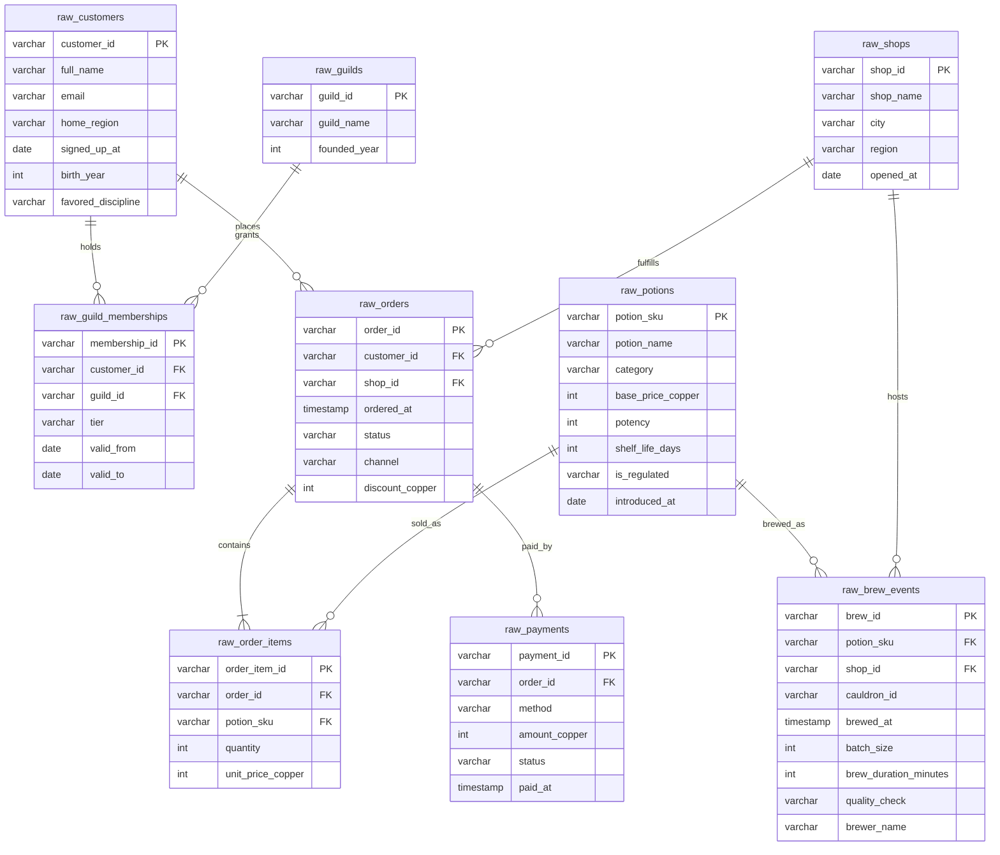

# 🧙 Merlin & Co. Apothecaries — ERD

Entity-relationship diagram for the **9 raw source tables** in `seeds/medium_data/`.
Types shown are logical staging targets; CSV columns arrive as text.

## Key facts

- Each raw relation keeps its documented event or entity grain.
- Referential integrity is intact; deliberate cleanup work is in formats and casing.
- `raw_shops.region` is canonical for regional conformance.
- `raw_brew_events` is one row per brew and may contain null durations.
